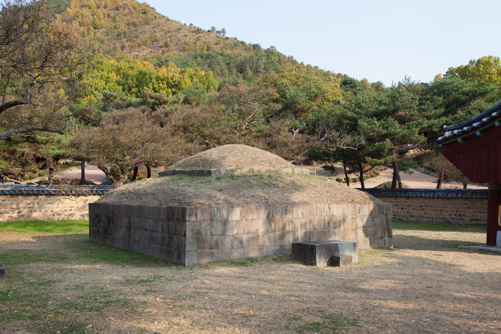
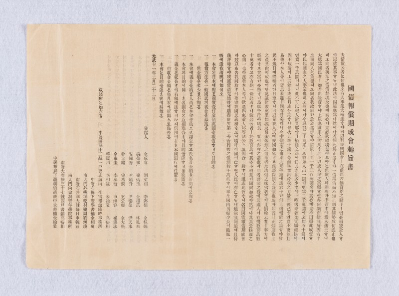

# **대구의 역사**
- 작성자 : 사학과 20학번 진명원

- 대구 겸상감영 전경

대구는 한반도의 역사에서 영남지방의 교통,물류의 중심에 있는 중추도시로서 오랫동안 기능해왔으며, 역사적으로 중요한 사건들이 여러 차례 일어난 장소이다. 
본 글에서는 아직 대구라는 지명이 불리기 훨씬 이전의 선사시대에서부터 근현대에 이르기까지 대구의 역사를 간략히 알아보아, 대구라는 지역이 한반도의 역사에서 어떠한 역할들을 하였는지 이해하는데 도움이 되고자 한다. 

---

## 1. 한반도에서 대구의 첫 등장
### 선사시대의 대구

- 대구 비산동 출토 금동관

대구에서 인류가 최초로 거주한 흔적이 발견되었던 것은 하빈면 감문리, 월성동, 서변동 유적 등이 있는데, 이 유적들에서 구석기시대의 유물이 발견되면서 대략 6~4만년전부터 대구 지역에 인류가 거주하였던 것으로 추정된다. 또한 청동기 및 초기철기시대의 유물 및 유적 또한 많이 출토되었고, 특히 고인돌이 해방 이전에는 많이 분포되어 있었으나 도시 건설과 시가지를 확장하는 과정에서 대부분 사라지고 말아 현재는 찾아보기 어렵다.  
대구에서 출토된 선사시대의 유물은 세형동검 및 청동거울, 꺾창 등 다양한 유물이 출토되었으며 특히 비산동에서 출토된 청동기 일괄은 국보 제 137호로 지정되어 그 가치를 인정받고 있다. 

---
## 2. 삼국시대의 대구
### 달구벌이라 불렸던 삼국시대의 대구, 그리고 그 위상
삼국이 성립되기 이전 달성토성을 중심으로 한 달구벌국이라는 소국이 존재했던 것으로 추정되는 대구는 이후 신라가 성장하여 흡수된 이후에도 신라의 주요 정치집단의 거주지 중 하나가 되었으며, 기존 소국의 명칭을 따 달구벌로 불리게 되었다. 현재에는 주택가 건립 등으로 인해 그 거주지 흔적을 찾아보기 어렵지만 과거에는 비산동과 내당동 일대에 87기의 삼국시대 고분들이 남아있었으며, 고분들에서 금동관과 금제귀걸이 등의 유물이 출토되어 귀족 및 유력 정치집단이 대구에 거주하였던 것을 확인할 수 있었다.
통일신라의 신문왕 대에 도읍을 경주에서 달구벌로 옮기려고 시도(귀족들의 반대로 시행되지는 못했다)하였던 점이나, 신라 오악(五岳)의 다섯 명산 가운데 팔공산이 중악으로 불리며 숭배되었던 점들을 고려하면, 당시 대구와 대구에 거주하던 정치집단의 위상이 높은 위치에 있었다고 생각해볼 수 있다.
### 대구 지명의 첫 등장
신라의 행정체계에서 대구 지역은 위화군과 달구화현으로 나누어서 불리고 있었는데, 경덕왕 16년(757년)에 위화현이 수성군으로, 달구화현이 대구현으로 개칭되면서 大丘라는 지명이 처음으로 역사에 등장하게 되었다. 이후 약 1천년이 넘는 시간 동안 '대구'라는 이름으로 역사에 남겨지기 시작했고, 조선시대 후기에 그 한자의 변화가 있기는 하였지만 오늘날까지도 그 이름이 유지되었다.

---
## 3. 고려시대의 대구
### 후삼국 경쟁의 격전지 대구

- 대구 신숭겸장군 유적지

고려시대에 대구에 있었던 역사적 사건 중 하나로 팔공산에서 이뤄진 공산전투가 있다. 공산전투는 고려와 후백제가 후삼국 통일을 위한 세력다툼의 주요 격전 중 하나였는데, 이를 통해 신라 말~후삼국 시기까지도 신라의 왕경이었던 경주와 가까운 군사, 교통 요충지로 대구가 기능하고 있었다고 추정할 수 있다. 더불어 이 전투에서 고려가 패배하고 왕건이 위기에 처했을 때 대신 희생하기를 자처하였던 신숭겸을 기리는 유적이 현재의 대구 지묘동에 위치하고 있다.  
또한 과거에는 대구 부인사에 거란 침입 당시 부처의 힘을 빌어 극복하고자 만들었던 초조대장경이 소장되어 있었는데, 아쉽게도 몽골이 침입하였을 때 소실되어 현재는 찾아볼 수 없다. 다만 국난 극복을 위해 국가 차원에서 만들어진 대장경이 대구에 소장되어있었던 점을 통해서 앞서 공산전투 때에도 언급했던 대구라는 지역의 위상이나 군사적, 지리적 이점을 추정해볼 수 있다.

---
## 4. 조선시대의 대구
### 영남지방의 중심으로 성장하기 시작한 대구
조선시대에 대구는 농업의 주요 생산지로 인구가 점차 증가하였고 이에 힘입어 세종 대에는 대구현에서 대구군으로 승격되었다. 대구가 오늘날과 같이 영남지방 교통,물류의 중심지 중 하나로 성장하게 된 것은 임진왜란 이후인데, 군사체계가 변화하면서 대구는 지리적 요충지로서 인정받아 경상감영이 설치됨에 따라 군사적 주요 지점 중 하나가 되었으며, 이에 따라 행정적인 지원과 성장도 더해졌고, 효종 대에는 약령시장이 개설되며 명실상부 영남 교통, 군사, 물류의 중심지로 자리잡게 되었다.

### 대구 한자의 변화 및 정착
조선 후기에 대구 지명의 한자가 大丘에서 오늘날의 大邱로 변화하게 되었는데, 이는 이전의 지명에 사용하던 丘 자가 공자의 본명인 孔丘에 들어가는 한자였기 때문에 성인의 이름자를 쓰는 것을 피하는 '피휘'를 해야한다며 영조 대의 유학자들이 상소를 올려 주장했다. 이후 당시 성리학적 질서가 지방에 깊게 뿌리잡았던 조선 후기에 大邱라고 쓰는 것이 일종의 관행처럼 굳어졌으며 근현대에 들어서며 大邱가 공식 명칭으로 굳어지게 되었다.  

---
## 5. 근현대의 대구
### 국채보상운동의 시작, 대구

- 국채보상기성회 취지서

개항기부터 일제의 국권침탈까지 기간에 몇 차례의 행정체계 변화 속에서 대구부, 대구군 등 체계 명칭의 변화는 있었지만 대구는 계속해서 영남지방의 중추기능을 수행했으며 관할구역에도 큰 변화는 없었다.
1907년에는 서상돈, 김광제 등을 중심으로 일제의 국권침탈을 막기 위해 금연, 금주를 통해 나라의 빚을 갚고자 했던 국채보상운동이 대구에서 자발적으로 전개되었는데 점차 전국적인 호응을 받게 되어, 약 25만명의 백성들이 참여하였던 범국민적인 경제 주권 수호운동으로서 평가받고 있다. 비록 일제의 방해로 인해 점차 운동이 쇠락하며 국권 침탈을 막지는 못하였지만, 모집한 의연금은 후에 한국의 민립대학 설립운동의 재정적 기초가 되어 국권을 위한 그 의지가 이어지게 되었다.

### 일제강점기의 대구
일제강점기 대구에서도 다양한 항일 독립운동이 전개되었는데, 1915년에는 박상진, 유상태 등을 중심으로 비밀결사인 조선국권회복단을 조직하여 독립운동을 펼쳤고, 3.1 운동 시기에는 서문시장을 중심으로 만세시위가 일어나 경북 전역으로 확장되었다.
1927년 신간회 대구지부가 결성되어 독립운동을 하였고, 의열단의 장진홍이 조선은행 대구지점을 폭파하는 무장투쟁을 하였으며, 이후 1930년대에도 학생들의 비밀결사 운동이 계속되는 등 다양한 독립운동이 일어났다.

### 해방 이후 오늘날에 대구에 이르기까지

- 2.28 민주운동

해방 직후 대구는 1948년에 지방자치법이 실시되며 대구부에서 대구시로 개칭되었는데, 1950년에는 6.25 전쟁 초기 북한에 밀려 경상도 일부 지역만 남았을때 낙동강방어전선의 중심 역할을 하였다.
1960년에는 이승만 정부 및 여당이었던 자유당의 독재를 반대하는 2.28 민주운동이 대구의 고등학생을 중심으로 전개되었는데, 이는 대한민국 최초의 자발적인 민주화 운동이었으며, 이후 3.15 마산의거와 4.19혁명으로 이어져 대한민국 민주화 운동의 계보를 만들게 되었다.  
대구시는 점차 주변의 여러 행정구역들을 흡수 편입하며 그 규모를 확장하였는데, 1981년에는 달성군의 월배읍, 성서읍, 공산면, 칠곡군의 칠곡읍, 경산군의 안심읍, 고산면을 편입하여 대구직할시로 승격되었으며, 1995년에 달성군을 편입함으로서 현재처럼 광역시가 되었고 영남권 중추도시로서의 위상을 확립하게 되었다. 2023년에는 군위군을 편입하여 전국의 특별시, 광역시 가운데 가장 큰 면적의 시역을 가지게 되었다.

---
## 6. 한반도 역사에서의 대구

대구는 신라 왕경 주변의 달구벌 시기부터 지리적 이점을 살려 그 위상을 키워왔으며, 여러 역사적 사건의 무대로서 그 이름을 기록에 남겨왔다. 특히 임진왜란 이후 조선 후기 때부터는 영남 지방의 중심 지역 중 하나로 성장하여 물류, 교통, 군사를 총괄하였고 이는 근현대와 해방 이후에도 계속되어 오늘날 광역시라는 행정 단위로 연결되었기에, 한반도의 역사 2천년의 시간 동안 대구는 경상도의 중심 지역이었다고 할 수 있다.

---
## 참고자료
### [대구광역시 역사-대구시청](https://www.daegu.go.kr/index.do?menu_id=00000264)
### [대구광역시-한국민족문화대백과사전](https://www.daegu.go.kr/index.do?menu_id=00000264)
### [국채보상운동 홈페이지](http://www.gukchae.com/)
### [2.28민주운동 기념사업회](https://www.228.or.kr/front/)
### [한국사데이터베이스](https://db.history.go.kr/)
