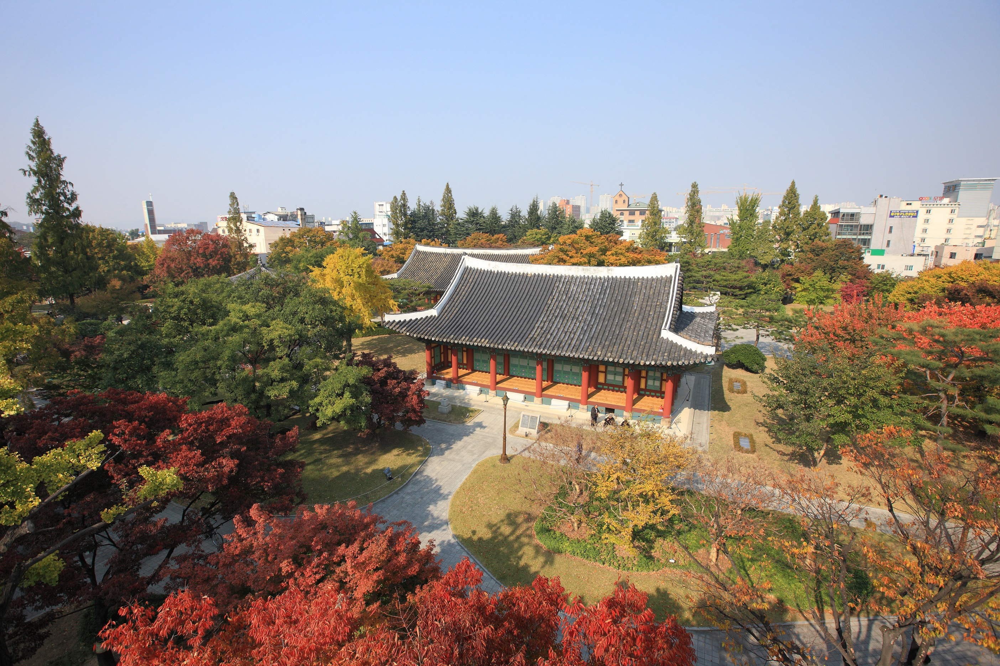

# **대구의 역사**
- 작성자 : 사학과 20학번 진명원

[ ] 이미지 크기 조정필요
---

## 1. 한반도에서 대구의 첫 등장
### [ ] 대구의 역사 소개 문구 ; 작성할 내용이 부족할 시 이후 세부 목차를 서술하고 선사시대 내용으로 자연스럽게 연결하는 것으로 수정
### [ ] 대구 지역의 선사시대 관련 유물, 발굴 등 정리
---
## 2. 삼국시대의 대구
### [ ] 삼국시대 대구의 주요역사 정리
### [ ] 대구 명칭의 첫 등장
---
## 3. 고려시대의 대구
### [ ] 고려시대 대구의 주요역사 정리 
---
## 4. 조선시대의 대구
### [ ] 조선시대 대구의 주요역사 정리
### [ ] 대구 한자의 변화 및 정착
---
## 5. 근현대의 대구
### [ ] 개항기 대구의 주요역사 정리
### [ ] 일제강점기 대구의 주요역사 정리
### [ ] 해방 이후 대구의 주요역사 정리
---
## 6. 한반도 역사에서 대구의 입지와 평가
### [ ] 조선시대 이전 대구에서의 역사적 사건, 평가 등 정리하여 간략하게 작성
### [ ] 임진왜란 이후부터 경상도의 주요 거점 및 중심지 중 하나로 성장한 내용, 일제강점기~근현대 대구의 역할 등 작성

---
## 참고자료
